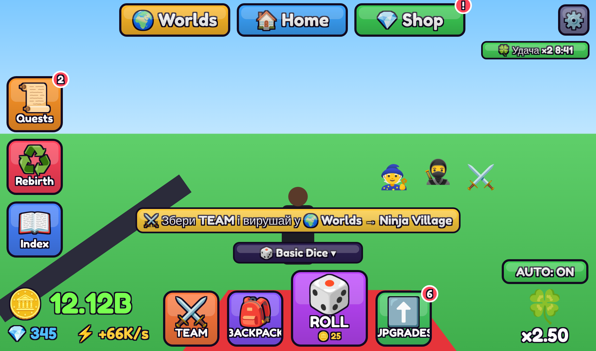
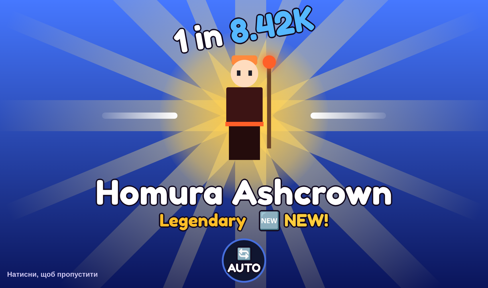
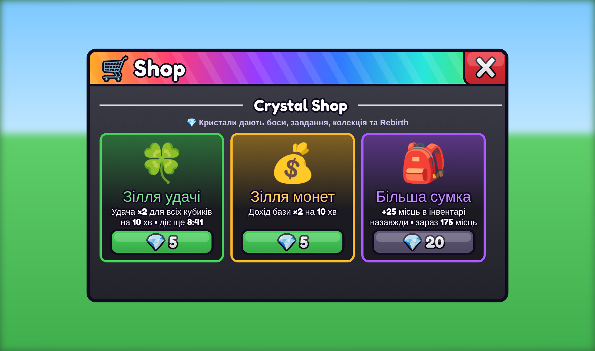
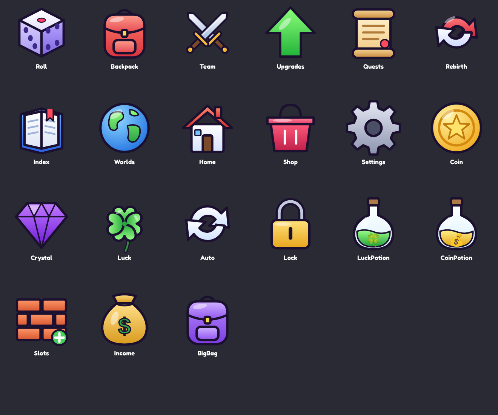
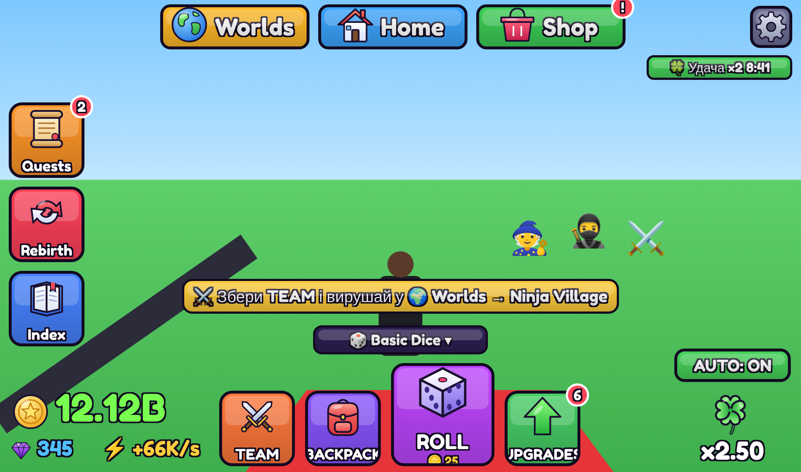

# Anime Dice: Awakening — етапи 1–5

Аніме-симулятор для Roblox: кидаєш кубик → отримуєш героя → ставиш його на базу або в бойову команду → герої заробляють монети й б'ються → купуєш покращення й сильніші кубики.

Готово:

- **Етап 1:** вхід у гру → видача бази → кидок кубика → отримання героя → інвентар → розміщення героя → нарахування монет → збереження прогресу.
- **Етап 2:** бойова команда з 3 героїв → герої йдуть за гравцем → портал у **Ninja Village** → вибір ворога → автоатака (шкоду рахує сервер) → 3 види ворогів і бос **Oni Warlord Kurogane** з помітними атаками → нагороди в Coins і Crystals.
- **Етап 5:** **пробудження героїв** (макс. рівень + 💎 → пробуджена форма з новим ім'ям, золотим німбом і множником сили) → **♻️ Rebirth** (віддаєш монети й слоти → назавжди +50% доходу, +5% удачі, кристали) → **новий інтерфейс** у стилі аніме-симуляторів.
- **Етап 4:** новий світ **Pirate Island** (відкривається перемогою над Oni) → 3 нові вороги та бос **Captain Blackwake** з трьома атаками → свої зони острова → перемога над капітаном відкриває **🌊 Tidal Dice** → 2 нові водні герої, 5 нових сюжетних завдань.
- **Етап 3:** вікно **Quests** (11 сюжетних і 3 щоденні завдання) → **колекція** героїв (+2% доходу за кожного відкритого й нагороди в Crystals) → **зони** Ninja Village відкриваються перемогами → **Crystal Shop**: зілля удачі, зілля монет, більша сумка.

---

## 1. План розробки

| Етап | Що з'явиться | Статус |
|---|---|---|
| **1. Основний цикл** | Бази, 5 кубиків, 6 рідкостей, 22 герої, шанси в UI, удача, гарантія (pity), анімація з пропуском, Auto Roll після навчання, інвентар (сортування, Lock, Merge, Sell, Equip Best), дохід і офлайн-дохід, покращення, налаштування, DataStore | ✅ готово |
| **2. Бої** | Team з 3 героїв (герой або на базі, або в команді), герої йдуть за гравцем і б'ють вибраного ворога, світ «Ninja Village», 3 вороги + бос, Crystals за боса | ✅ готово |
| **3. Прогрес** | Завдання (Quests), колекція героїв з нагородами, відкриття зон, покупки за Crystals | ✅ готово |
| **4. Pirate Island** | Другий світ, вимога для входу, бос-капітан, Tidal Dice за боса, нові герої й завдання | ✅ готово |
| **5. Пробудження й Rebirth** | Awakened-форми, Rebirth, новий інтерфейс | ✅ готово |
| 6+. Світи | Demon Night City, Magic Academy, Sky Arena | далі |
| 5. Пробудження | Awakened-форми, Rebirth, складні еволюції | |
| 6. Поліровка | Звуки, частинки, бусти удачі, баланс | |

---

## Новий інтерфейс



*Макет (HTML-імітація з тими самими розмірами й кольорами; у грі фоном буде твій світ).*

| Показ кидка | Вікна (на прикладі Shop) |
|---|---|
|  |  |

**Кидок:** герої швидко змінюють один одного й сповільнюються, як у слот-машині, а потім зупиняються на тому, якого вже вибрав сервер. Герой — справжня 3D-модель (ViewportFrame), що повільно повертається; над ним нахилений шанс «1 in 8.42K» (рахується для вибраного кубика з урахуванням удачі), під ним — ім'я, рідкість і NEW!; позаду — кольорові промені та сяйво, з боків — білі «леза». Кругла кнопка **AUTO** внизу вмикає автокидки прямо під час показу.

**Вікна:** темне тіло, яскрава градієнтна шапка зі смугами (у Shop — веселкова), великий червоний **X**, картки з товстою кольоровою рамкою й світінням, зелені кнопки цін, розділювачі секцій. Світ позаду відкритого вікна розмивається.

| Місце | Що там |
|---|---|
| Зверху | 🌍 **Worlds**, 🏠 **Home** (додому з будь-якого світу), 💎 **Shop** (кристальний магазин); ⚙️ праворуч |
| Ліворуч | 📜 **Quests**, ♻️ **Rebirth**, 📖 **Index** (колекція) — з червоними лічильниками нагород |
| Внизу | ⚔️ **TEAM**, 🎒 **BACKPACK**, великий 🎲 **ROLL** (кидає одразу, показує ціну), ⬆️ **UPGRADES** (лічильник доступних покращень) |
| Над ROLL | вибір кубика (відкриває вікно з шансами) |
| Внизу ліворуч | 🪙 гроші великими зеленими цифрами, 💎 кристали, ⚡ дохід |
| Внизу праворуч | **AUTO** і 🍀 поточна удача (кубик × зілля × Rebirth) |

Усі кнопки — з градієнтом, «блиском», товстою темною обводкою й білим текстом з контуром; іконки — емодзі, тож не потрібні жодні завантажені картинки. Вікна мають кольорову шапку під колір кнопки й «вистрибують» при відкритті.

## Ассети: іконки та звуки



У грі є **власний набір із 21 іконки** в стилі симуляторів: `assets/icons/*.png` (512×512, прозорий фон). Іконки намальовані для цієї гри, тож ти можеш вільно використовувати їх у своїй грі. Вихідні SVG лежать у `assets/icons-src/`, а генератор — `tools/make_icons.py`.



**Як підключити (≈5 хвилин):**

1. Studio → **View → Asset Manager** → вкладка **Images** → кнопка **Bulk Import** (іконка зі стрілкою вгору) → вибери всі файли з `assets/icons/` → **Open**. (Місце має бути опубліковане — File → Publish to Roblox.)
2. Для кожної картинки: ПКМ → **Copy ID to Clipboard**.
3. Встав ID у `ReplicatedStorage/Shared/Config/AssetConfig` у рядок з тією самою назвою, наприклад:
   ```lua
   Roll = "rbxassetid://1234567890",
   ```
   (можна й просто `"1234567890"`).
4. **Play** — усі кнопки, гроші, кристали, удача, AUTO й картки магазину покажуть картинки замість емодзі.

Поки поле порожнє, гра показує емодзі, тож підключати можна поступово.

**Звуки** (`AssetConfig.Sounds`): Click, RollTick (прокрутка героїв), Reveal, RareReveal (Legendary+), Purchase, Reward, Error. Візьми будь-які безкоштовні звуки з **Toolbox → Audio** (найкраще ті, що опубліковані акаунтом Roblox) → ПКМ → **Copy Asset ID** → встав у відповідний рядок. Звуки поважають налаштування ⚙️ «Звук».

Також можна вставляти ID будь-яких інших картинок з Toolbox (вкладка Images) — механізм той самий.

## 2. Структура Explorer

```
Workspace                 ← лобі, ділянки та світи будуються кодом під час запуску
ReplicatedStorage
└─ Shared                       (Folder)
   ├─ Config                    (Folder)
   │  ├─ RarityConfig           (ModuleScript)  рідкості, кольори, ефекти
   │  ├─ DiceConfig             (ModuleScript)  кубики, ціни, ваги, удача
   │  ├─ HeroConfig             (ModuleScript)  усі герої
   │  ├─ EconomyConfig          (ModuleScript)  баланс: слоти, дохід, гарантія
   │  ├─ WorldConfig            (ModuleScript)  світи
   │  ├─ CombatConfig           (ModuleScript)  команда, дальність атаки
   │  ├─ EnemyConfig            (ModuleScript)  вороги, бос, точки появи, зони
   │  ├─ AssetConfig            (ModuleScript)  🖼 ID іконок і звуків
   │  ├─ QuestConfig            (ModuleScript)  ⭐ завдання, нагороди колекції
   │  └─ ShopConfig             (ModuleScript)  ⭐ зілля, сумка, бусти
   ├─ GameMath                  (ModuleScript)  формули для сервера й клієнта
   ├─ HeroModelBuilder          (ModuleScript)  🔁 модель героя з Part (з етапу 2 — тут!)
   └─ Remotes                   (ModuleScript)  список RemoteEvent/RemoteFunction
ServerScriptService
├─ Main                         (Script)        запуск сервера
└─ Services                     (Folder)
   ├─ DataService               (ModuleScript)  DataStore, автозбереження, замок сесії
   ├─ PlotService               (ModuleScript)  лобі, ділянки, герої на слотах
   ├─ RollService               (ModuleScript)  кидки (результат — на сервері)
   ├─ InventoryService          (ModuleScript)  Place/Remove/Lock/Sell/Merge/Equip Best
   ├─ IncomeService             (ModuleScript)  монети щосекунди + офлайн
   ├─ UpgradeService            (ModuleScript)  покупка слотів і доходу
   ├─ SettingsService           (ModuleScript)  налаштування гравця
   ├─ RateLimiter               (ModuleScript)  обмеження частоти запитів
   ├─ BuildUtil                 (ModuleScript)  🆕 Part, написи, портали
   ├─ TeamService               (ModuleScript)  🆕 бойова команда
   ├─ EnemyModelBuilder         (ModuleScript)  🆕 моделі ворогів
   ├─ EnemyService              (ModuleScript)  🆕 вороги, нагороди, атаки боса
   ├─ CombatService             (ModuleScript)  🆕 вибір цілі й автоатака
   ├─ WorldService              (ModuleScript)  🆕 Ninja Village, портали, ворота зон
   ├─ QuestService              (ModuleScript)  ⭐ завдання, колекція, відкриття зон
   ├─ ShopService               (ModuleScript)  ⭐ покупки за Crystals
   └─ RebirthService            (ModuleScript)  🔥 Rebirth
StarterPlayer
└─ StarterPlayerScripts
   ├─ ClientMain                (LocalScript)   запуск інтерфейсу
   └─ Client                    (Folder)
      ├─ ClientState            (ModuleScript)  дані гравця на клієнті
      ├─ UIKit                  (ModuleScript)  кнопки, вікна, адаптивність
      ├─ Hud                    (ModuleScript)  валюти, меню, підказки
      ├─ RollUI                 (ModuleScript)  кубики та анімація кидка
      ├─ InventoryUI            (ModuleScript)  інвентар
      ├─ UpgradesUI             (ModuleScript)  покращення
      ├─ SettingsUI             (ModuleScript)  налаштування
      ├─ WorldEffects           (ModuleScript)  вмикання/вимикання аур
      ├─ EnemyRegistry          (ModuleScript)  🆕 пошук ворогів на клієнті
      ├─ FollowerController     (ModuleScript)  🆕 герої йдуть за гравцем
      ├─ CombatUI               (ModuleScript)  🆕 ціль, смуга боса, цифри шкоди
      ├─ TeamUI                 (ModuleScript)  🆕 вікно Team
      ├─ WorldsUI               (ModuleScript)  🆕 вікно Worlds
      ├─ QuestsUI               (ModuleScript)  ⭐ вікно Quests (завдання + колекція)
      ├─ RebirthUI              (ModuleScript)  🔥 вікно Rebirth
      ├─ SoundController        (ModuleScript)  🖼 звуки інтерфейсу
      └─ ZoneGates              (ModuleScript)  ⭐ ворота зон на екрані гравця
```

🆕 — з'явилось на етапі 2, ⭐ — на етапі 3, 🔥 — на етапі 5, 🖼 — ассети, 🔁 — перенесено.

Папку `ReplicatedStorage.Remotes` створювати **не потрібно** — сервер створює її сам.

**Хто за що відповідає:**
- `ModuleScript` у `Config` — лише числа й тексти. Баланс міняється тут, без правок логіки.
- `Script` + `Services` — уся логіка й перевірки. Сервер вирішує результат кидка, рахує гроші, перевіряє, чи гравець володіє героєм.
- `LocalScript` + `Client` — лише показ: інтерфейс, анімації. Клієнт тільки просить сервер («кинь кубик», «постав героя»).

---

## 3. Встановлення

### Спосіб A — найшвидший: відкрити готовий файл

1. Завантаж файл [`AnimeDiceAwakening.rbxlx`](AnimeDiceAwakening.rbxlx) з цієї папки.
2. Roblox Studio → **File → Open from File…** → вибери файл.
3. Переходь до розділу [4. Налаштування гри](#4-налаштування-гри).

### Спосіб B — вручну (щоб розібратися, як усе влаштовано)

Відкрий Studio → **New → Baseplate**. Увімкни вікна **View → Explorer** і **View → Properties**.

Як створювати об'єкти:
- **Folder / ModuleScript / Script / LocalScript**: наведи на батьківський об'єкт у Explorer → натисни **⊕** (або ПКМ → **Insert Object**) → введи назву класу.
- **Перейменування**: виділи об'єкт → **F2** (або ПКМ → Rename) → введи назву **точно як у таблиці** (з великими літерами).
- **Вставка коду**: двічі клацни скрипт → видали весь текст, що там є (`print("Hello world!")` або `local module = {} ...`) → встав код із файлу.

Тип об'єкта видно із закінчення файлу в репозиторії:

| Закінчення файлу | Що створити в Studio | Назва об'єкта |
|---|---|---|
| `Main.server.lua` | **Script** | `Main` |
| `ClientMain.client.lua` | **LocalScript** | `ClientMain` |
| `НазваМодуля.lua` | **ModuleScript** | `НазваМодуля` |

Порядок створення (папка `src/` → Explorer):

1. **ReplicatedStorage**
   - Folder `Shared`
     - Folder `Config` → 10 ModuleScript з `src/ReplicatedStorage/Shared/Config/*.lua`
     - ModuleScript `GameMath`, `HeroModelBuilder`, `Remotes` ← `src/ReplicatedStorage/Shared/*.lua`
2. **ServerScriptService**
   - Script `Main` ← `src/ServerScriptService/Main.server.lua`
   - Folder `Services` → 17 ModuleScript з `src/ServerScriptService/Services/*.lua`
3. **StarterPlayer → StarterPlayerScripts**
   - LocalScript `ClientMain` ← `src/StarterPlayer/StarterPlayerScripts/ClientMain.client.lua`
   - Folder `Client` → 17 ModuleScript з `src/StarterPlayer/StarterPlayerScripts/Client/*.lua`

Звір свій Explorer зі схемою з розділу 2 — кожна назва має збігатися літера в літеру.

#### Оновлення з етапу 1 до етапу 2 (якщо ставив вручну)

1. **Перенеси** `HeroModelBuilder` з `ServerScriptService/Services` у `ReplicatedStorage/Shared` (перетягни мишею в Explorer) і заміни його код.
2. **Створи нові** ModuleScript (позначені 🆕 у розділі 2): 2 у `Config`, 6 у `Services`, 5 у `Client`.
3. **Заміни код повністю** у змінених скриптах: `WorldConfig`, `GameMath`, `Remotes`, `Main`, `DataService`, `InventoryService`, `PlotService`, `Hud`, `InventoryUI`, `ClientMain`.

Прогрес гравців з етапу 1 зберігається: нові поля (команда, статистика) додаються автоматично.

#### Оновлення з етапу 4 до етапу 5 (якщо ставив вручну)

1. **Створи** `RebirthService` у `Services` і `RebirthUI` у `Client`.
2. **Заміни код повністю** в: `EconomyConfig`, `RarityConfig`, `QuestConfig`, `GameMath`, `HeroModelBuilder`, `Remotes`, `Main`, `DataService`, `InventoryService`, `TeamService`, `PlotService`, `CombatService`, `UIKit`, `Hud`, `RollUI`, `InventoryUI`, `UpgradesUI`, `QuestsUI`, `TeamUI`, `WorldsUI`, `SettingsUI`, `CombatUI`, `FollowerController`, `ClientMain`.

Простіше відкрити готовий `.rbxlx` — інтерфейс змінено майже скрізь.

#### Оновлення з етапу 3 до етапу 4 (якщо ставив вручну)

Нових скриптів немає — **заміни код повністю** в: `DiceConfig`, `EnemyConfig`, `HeroConfig`, `QuestConfig`, `WorldConfig`, `GameMath`, `DataService`, `QuestService`, `RollService`, `EnemyService`, `EnemyModelBuilder`, `WorldService`, `RollUI`, `WorldsUI`, `ZoneGates`.

Старі збереження переносяться автоматично: усі минулі перемоги зараховуються в Ninja Village (зони там лишаються відкритими), а хто вже перемагав Oni — одразу може плисти на Pirate Island.

#### Оновлення з етапу 2 до етапу 3 (якщо ставив вручну)

1. **Створи нові** ModuleScript (позначені ⭐): `QuestConfig`, `ShopConfig` у `Config`; `QuestService`, `ShopService` у `Services`; `QuestsUI`, `ZoneGates` у `Client`.
2. **Заміни код повністю**: `WorldConfig`, `EnemyConfig`, `EconomyConfig`, `GameMath`, `Remotes`, `Main`, `DataService`, `RollService`, `InventoryService`, `UpgradeService`, `IncomeService`, `EnemyService`, `CombatService`, `WorldService`, `Hud`, `RollUI`, `InventoryUI`, `UpgradesUI`, `ClientMain`.

Збережений прогрес не губиться: завдання, колекція (уже відкриті герої зараховуються) та бусти додаються автоматично.

### Спосіб C — Rojo (для тих, хто працює у VS Code)

```bash
rojo serve        # жива синхронізація зі Studio (плагін Rojo)
rojo build -o AnimeDiceAwakening.rbxlx   # перезібрати готовий файл
```

---

## 4. Налаштування гри

Щоб збереження працювало в Studio:

1. **File → Publish to Roblox** (створи новий досвід — DataStore працює лише в опублікованих місцях).
2. **Home → Game Settings → Security** → увімкни **Enable Studio Access to API Services** → **Save**.
3. **Game Settings → Places → ⋯ → Configure** (або на сайті Creator Hub) → **Max Players = 6** (на сервері 6 ділянок).

Якщо пункти 1–2 не зроблено, гра все одно запуститься, але з'явиться червоне повідомлення «Режим Studio: прогрес не зберігається». Це навмисно: при помилці доступу до DataStore гра **ніколи** не записує порожні дані поверх справжніх.

---

## 5. Перевірка етапу 1 (кнопка **Play**)

| # | Дія | Що має статися |
|---|---|---|
| 1 | **Play** | В Output: `[Main] Anime Dice: Awakening — сервер запущено` і `[Main] Player1 завантажений: 60 монет`. Ти з'являєшся біля входу на ділянку з табличкою «База <твоє ім'я>». Навколо — лобі з 5 порталами та ще 5 вільних ділянок. |
| 2 | Подивись на екран | Зверху 🪙 60, 💎 0, +0/s. Знизу кнопки Roll, Inventory, Team, Upgrades, Quests, Worlds, ⚙️. Жовта підказка «Натисни Roll…». |
| 3 | **Roll** | Вікно з 5 кубиками. Basic відкритий, інші — 🔒 з лічильником кидків. Праворуч шанси рідкостей та «гарантовано через N кидків». Кнопка **ROLL 🎁 FREE!** |
| 4 | **ROLL** | Кубик крутиться ~1 с → картка героя (рідкість, ім'я, стихія, статистика, 🆕 NEW!, 🎁 Безкоштовно). Клік по екрану пропускає анімацію. Монети не списались. |
| 5 | **Inventory** → клік по картці героя → **Place** | Повідомлення «Героя поставлено на базу» і «Навчання завершено! Auto Roll відкрито». На першому слоті з'являється модель героя з іменем і доходом. |
| 6 | Почекай 10 с | Монети ростуть щосекунди, зверху +1/s (або більше). |
| 7 | Roll ще кілька разів | Кожен кидок −25 🪙. Коли монет < 25 — «Не вистачає монет». |
| 8 | **Auto: ON** | Кидки йдуть самі, поки вистачає монет. **Skip: ON** — замість анімації коротке повідомлення. |
| 9 | Inventory: **↕ Сортування**, **⭐ Equip Best**, **🔒 Lock**, **⬆️ Merge**, **💰 Sell** | Сортування змінює порядок; Equip Best ставить найприбутковіших; заблокованого або поставленого на базу героя продати не можна; Merge з'їдає дублікат і дає +1 рівень. |
| 10 | **Upgrades** → купи слот | На базі відкривається 4-й слот (знімається 🔒). |
| 11 | **⚙️** → вимкни **Ефекти** | Аури Epic+ героїв зникають (лише на твоєму екрані). |
| 12 | **Stop**, потім знову **Play** | Монети, герої, слоти й налаштування на місці. Якщо минуло кілька хвилин — повідомлення про офлайн-дохід. |

> Швидко отримати рідкісного героя для перевірки ефектів: у `DiceConfig` тимчасово постав `Legendary = 100000` у кубика Basic. Не забудь повернути!

### Перевірка етапу 2 — бої

| # | Дія | Що має статися |
|---|---|---|
| 1 | Зроби 5+ кидків | Жовта підказка: «Збери команду в Team і вирушай у Worlds → Ninja Village». |
| 2 | **⚔️ Team** → натисни на героя | Він займає слот команди і стає поруч із тобою (трохи менший, з написом ⚔️ шкода). Якщо він стояв на базі — зникає зі слота бази. |
| 3 | **⭐ Best Team** | У команду стають 3 найсильніші герої, яких немає на базі. Видно «Шкода команди: N/s». |
| 4 | Пробіжись | Герої йдуть за тобою: двоє по боках, один позаду, злегка підстрибуючи. |
| 5 | **🌍 Worlds → Ninja Village → Travel** (або зайди в зелений портал у лобі) | Переносить до червоних воріт torii. Видно будинки, сакури, 6 ворогів і великого червоного боса на кам'яній арені вдалині. Праворуч кнопки 🎯 Target / ✖ Stop / 🏠 Lobby. |
| 6 | Натисни на **Bandit Genin** (мишею або пальцем) | Зверху — смуга «🎯 Bandit Genin» зі здоров'ям. Герої повертаються до нього, летять кольорові снаряди, над ворогом — жовті цифри шкоди. |
| 7 | Відійди далеко | У смузі цілі: «— підійди ближче!». Атаки припиняються. |
| 8 | Добий ворога | Вибух, повідомлення «Переможено Bandit Genin! +12 🪙». Через 8 с ворог з'являється знову. |
| 9 | **🎯 Target** | Автоматично вибирається найближчий ворог. |
| 10 | Підійди до боса | Зверху велика смуга «👹 Oni Warlord Kurogane». Кожні 5 с: «⚠️ Ground Slam!» (червоне коло навколо боса) або «⚠️ Shuriken Rain!» (коло під тобою). Не вийшов — втрачаєш здоров'я. |
| 11 | Перемож боса (потрібна команда з Epic/Legendary) | «+1500 🪙 +25 💎», кристали видно зверху та в списку гравців. Бос повертається через 90 с. |
| 12 | Загинь від боса або натисни **🏠 Lobby** | Повертаєшся на свою базу. |
| 13 | Inventory: спробуй продати героя з команди | «Спершу прибери героя з команди». На картці героя з команди значок ⚔️. |
| 14 | Stop → Play | Команда збереглась. |

> Для швидкої перевірки боса: у `EnemyConfig` тимчасово зменш `health` боса до `300` і в `WorldConfig` — `requiredKills` зон до `1`.

### Перевірка етапу 3 — прогрес

| # | Дія | Що має статися |
|---|---|---|
| 1 | Зроби перший кидок | На кнопці **📜 Quests** з'являється червоний «!». |
| 2 | **Quests → 📜 Завдання** | Сюжетне «1. Перший кидок» з повною смугою і кнопкою **🎁 Claim**. Нижче — 3 щоденні завдання й таймер «нові через …». |
| 3 | **Claim** | «+50 🪙», відкривається завдання 2 «Будівничий». «!» зникає, якщо більше нічого забирати. |
| 4 | Зроби 20 кидків / переможи ворогів | Смуги щоденних завдань ростуть; виконані — зелені з Claim. |
| 5 | **📖 Колекція** | «Відкрито N / 22 • бонус доходу +X%». Відкриті герої кольорові, невідомі — «???» з рідкістю. Дохід зверху (+N/s) став більшим на 2% за кожного героя. |
| 6 | Відкрий 5 героїв → кнопка «🎁 5 героїв +5 💎» | Кристали зараховано, кнопка стає «✅». |
| 7 | **Ninja Village** | Між ляльками та ронінами — рожева стіна-ворота «🔒 Dojo — перемоги: 3 / 15». Крізь неї не пройти, ронінів не можна вибрати («Ця зона ще закрита»). |
| 8 | Переможи 15 ворогів | «🔓 Відкрито зону Dojo у Ninja Village!», ворота стають прозорими й прохідними **лише для тебе**. Арена боса — після 40 перемог. |
| 9 | **⬆️ Upgrades** → прокрути вниз до **💎 Crystal Shop** | Зілля удачі / монет по 5 💎, сумка 10 → 20 → 30 → 40 💎. |
| 10 | Купи **Зілля удачі** | Зліва вгорі «🍀 Удача ×2 9:59», у вікні Roll шанси рідкісних героїв зросли, «🍀 зілля активне!». Можна накопичити до 60 хв. |
| 11 | Купи **Зілля монет** | Дохід зверху подвоюється, поки йде таймер. |
| 12 | Купи **Більшу сумку** | В Inventory «Герої: N / 175». |
| 13 | Stop → Play | Завдання, колекція, бусти (таймер іде й офлайн) збережені. |

### Перевірка етапу 4 — Pirate Island

| # | Дія | Що має статися |
|---|---|---|
| 1 | **Worlds** до перемоги над Oni | Pirate Island: «🔒 Закрито», «Щоб відкрити: Переможи Oni Warlord Kurogane». Синій портал у лобі відповідає тим самим. |
| 2 | Переможи Oni | «🌍 Відкрито світ Pirate Island! Шукай його в Worlds». |
| 3 | **Travel → Pirate Island** | Пісочний острів посеред моря: дерев'яна арка «☠ PIRATE ISLAND ☠», пальми, хатинки, скрині, причал і чорний корабель позаду. |
| 4 | Бий **Deckhand Brawler** і **Cannon Crab** | Нагороди 70 і 160 🪙. Ворота «Smugglers' Cove — перемоги тут: N / 20» рахують **лише перемоги на острові**. |
| 5 | 20 перемог → **Cursed Corsair**, 60 → **Captain Blackwake** | Бос по черзі: «Cannon Barrage» (7 кіл по всьому причалу), «Anchor Sweep» (велике коло навколо нього), «Kraken Grab» (коло під кожним гравцем). |
| 6 | Переможи капітана | «+12K 🪙 +60 💎» і «🌊 Відкрито Tidal Dice!». |
| 7 | **Roll → Tidal Dice** | Удача ×2, водні герої (Tomo, Kaito, Coral Vex, Marisol, Kaizen) випадають утричі частіше. |
| 8 | **Quests → Колекція** | Тепер 24 герої та нові нагороди за 20 і 24. |

> Швидка перевірка: у `WorldConfig` прибери рядок `unlock = …` у PirateIsland, а в `EnemyConfig` зменш `health` капітана.

### Перевірка етапу 5 — новий інтерфейс, пробудження, Rebirth

| # | Дія | Що має статися |
|---|---|---|
| 1 | **Play** | Екран як на макеті вище. Підказка «👇 Натисни великий 🎲 ROLL». |
| 2 | Натисни великий **ROLL** | Кидок одразу (без відкриття вікна). Під написом ROLL — ціна; червона, якщо не вистачає. |
| 3 | Натисни **🎲 Basic Dice ▾** | Вікно кубиків з фіолетовою шапкою; вибраний кубик — з білою обводкою. Значок і ціна на ROLL змінюються. |
| 4 | **AUTO** (після навчання) | Автокидки; кнопка зелена «AUTO: ON». Під конюшиною — удача, напр. «x1.25» для Fire Dice. |
| 5 | Купи щось, поки є монети | На **UPGRADES** червоний лічильник доступних покращень. |
| 6 | **📖 Index** | Відкривається одразу вкладка «Колекція»; **📜 Quests** — вкладка завдань. |
| 7 | Підніми героя до макс. рівня (Merge) → **🎒 Backpack → ✨ Awaken N💎** | «✨ ... пробуджується!». Ім'я змінюється на пробуджене, золота рамка в рюкзаку; на базі й у команді — золотий німб і сяйво, дохід і шкода × множник. |
| 8a | Кидок | Замість кубика — прокрутка героїв, «1 in N», ім'я, рідкість, промені (як на макеті вище). Клік — пропустити. |
| 8b | Відкрий будь-яке вікно | Темне вікно з яскравою шапкою, світ позаду розмитий. |
| 8 | Збери 250K 🪙 → **♻️ Rebirth** | Прогрес-смуга, «Отримаєш / Скинеться». Перше натискання — «⚠️ Точно?», друге — Rebirth: монети 60, 3 слоти, дохід ×1.5, удача ×1.05, +10 💎. Герої на місці. |

> Швидка перевірка: у `EconomyConfig` → `Rebirth.baseCost = 100`, а в `RarityConfig` → `maxLevel = 2` для Common.

---

## 6. Перевірка з двома гравцями (**Start Server**)

1. Вкладка **Test** → у блоці **Clients and Servers** вибери **2 Players** → **Start**.
2. Відкриються 3 вікна: **Server** і два клієнти **Player1**, **Player2**.

Перевір:

| Що перевірити | Очікуваний результат |
|---|---|
| Бази | Кожен гравець з'явився на **своїй** ділянці, на табличках різні імена. |
| Кидки | Player1 кидає кубик — у Player2 монети й інвентар не змінюються. |
| Видимість | Player2 підходить до бази Player1 і бачить його героїв з аурами. |
| Список гравців (Tab) | У кожного свої Coins і Crystals. |
| Ефекти | Player1 вимикає ефекти — у Player2 аури лишаються. |
| Вихід | Закрий вікно Player2 → у Server-вікні ділянка стає «Вільна ділянка», герої зникають. |
| Збереження | Натисни **Cleanup** у Test і запусти знову — у кожного гравця свій прогрес. |
| Супутники | Обидва гравці в Ninja Village: кожен бачить героїв **обох** гравців, вони йдуть кожен за своїм господарем. |
| Спільний бій | Обидва б'ють одного ворога — обидва отримують нагороду (якщо зняли хоча б 3% його здоров'я). |
| Атаки боса | Shuriken Rain з'являється під **кожним** гравцем поруч із босом. |
| Різні світи | Player1 у лобі, Player2 у Ninja Village: у Player1 немає кнопок бою, у Player2 — є; смуга боса видна лише Player2. |
| Зони | Player1 відкрив Dojo, Player2 — ні: Player1 проходить крізь ворота, Player2 упирається в стіну. |
| Завдання | Щоденні завдання однакові в обох, прогрес — у кожного свій. |

Помилки сервера дивись в Output **вікна Server**, помилки інтерфейсу — в Output вікна клієнта.

---

## 7. Як влаштовано захист

**Сервер — головний.** Клієнт ніколи не повідомляє «я отримав Mythic» чи «у мене 1000 монет». Він лише просить, а сервер перевіряє й вирішує:

- **Кидок** (`RollService`): перевіряє тип аргументу, чи існує кубик, чи він відкритий, чи вистачає монет, чи не заповнений інвентар; ліміт частоти + пауза 0.5 с між кидками. Рідкість і героя вибирає сервер, клієнту надсилається вже готовий результат — анімація лише показує його.
- **Інвентар** (`InventoryService`): тільки дозволені дії, `uid` — рядок до 24 символів, герой має належати саме цьому гравцеві, заблокованого/поставленого не можна продати, герой не може бути одночасно на базі й у команді.
- **Покращення / налаштування**: білий список назв і типів значень.
- **Бій** (`CombatService`, `EnemyService`): клієнт лише вибирає ціль. Сервер перевіряє, що ворог живий, у тому ж світі й не далі 120 studs, а шкоду рахує сам за рівнем героя та швидкістю атаки, лише коли гравець не далі 45 studs. Нагорода — тільки тим, хто зняв ≥ 3% здоров'я ворога. Супутників малює кожен клієнт сам, але на шкоду це не впливає.
- **Команда** (`TeamService`): герой або на базі, або в команді — сервер сам переносить його між ними; продати чи «злити» героя з команди не можна.
- **Завдання й колекція** (`QuestService`): сервер сам рахує прогрес (кидки, перемоги, злиття, покупки), перевіряє виконання перед видачею нагороди й не дає забрати її двічі. Щоденні завдання змінюються за серверним часом UTC.
- **Магазин** (`ShopService`): ціни з `ShopConfig`, кристали списуються лише якщо їх вистачає; час дії зілля зберігається як серверний час закінчення, тож перевести годинник на телефоні марно.
- **Зони**: ворота прохідні тільки на екрані гравця, який їх відкрив. Навіть якщо хтось обійде стіну, сервер не дасть атакувати ворогів закритої зони.
- **RateLimiter** — «відро з жетонами» для кожного RemoteFunction: спам кнопками не перевантажує сервер.
- `Remotes.Handle` обгортає кожен обробник у `pcall` — помилка в коді не «підвішує» клієнта.

**Збереження** (`DataService`):
- до 5 спроб із паузою при помилках DataStore;
- якщо дані не завантажились — гравця відключають з поясненням, а збереження для нього **вимкнене**, тому старий прогрес не перезаписується порожнім;
- **замок сесії**: поки гравець на сервері A, сервер B чекає (до 30 с) і не відкриває ті самі дані — захист від втрати прогресу при швидкому переході між серверами;
- автозбереження кожні 60 с, збереження при виході та при вимкненні сервера (`BindToClose`);
- `reconcile` додає нові поля зі шаблону, коли ти розширюєш гру, а `sanitize` виправляє зламані значення.

**Офлайн-дохід** рахується за серверним часом `os.time()`: 50% звичайного доходу, максимум за 2 години.

---

## 8. Як змінювати баланс

| Хочу змінити | Файл |
|---|---|
| Ціну кидка, удачу, шанси, вимогу відкриття кубика | `Config/DiceConfig` |
| Стартові монети, ціни слотів і доходу, гарантію, офлайн-дохід | `Config/EconomyConfig` |
| Кольори рідкостей, ціни продажу, макс. рівень, автоблокування | `Config/RarityConfig` |
| Додати героя | `Config/HeroConfig` — скопіюй блок і дай **новий унікальний** `id` |
| Здоров'я й нагороди ворогів, атаки боса, точки появи | `Config/EnemyConfig` |
| Розмір команди, дальність атаки, поріг нагороди | `Config/CombatConfig` |
| Завдання, щоденні завдання, нагороди колекції | `Config/QuestConfig` |
| Ціни й тривалість зіль, сумка, сила бустів | `Config/ShopConfig` |
| Скільки перемог потрібно для зон, що відкриває світ | `Config/WorldConfig` → `zones`, `unlock` |
| Атаки боса (тип, радіус, шкода, попередження) | `Config/EnemyConfig` → `attacks` |
| Кубик за боса | `Config/DiceConfig` → `requiredBoss` |
| Ціна пробудження | `Config/RarityConfig` → `awakenCost`; сила — `HeroConfig` → `awakened.multiplier` |
| Ціна й бонуси Rebirth | `Config/EconomyConfig` → `Rebirth` |
| Кольори кнопок головного екрана | `Client/Hud` → `COLORS` |
| Бонус колекції до доходу | `Config/EconomyConfig` → `CollectionIncomeBonus` |

⚠️ Ніколи не видаляй і не перейменовуй `id` героя після того, як гравці його отримали — він зберігається в їхньому прогресі.

**Гарантія (pity):** якщо 40 кидків поспіль не випадав Epic або краще — 40-й кидок дає щонайменше Epic. Для Legendary — 250 кидків. Лічильник спільний для всіх кубиків.

**Удача:** вага кожної рідкості, крім Common, множиться на `luck` кубика. Тому в Celestial Dice (удача ×2.2) рідкісні герої випадають помітно частіше.

---

## 9. Типові проблеми

| Симптом | Причина і рішення |
|---|---|
| `Infinite yield possible on ... WaitForChild("Shared")` | Папка названа інакше або лежить не в ReplicatedStorage. Перевір назви з розділу 2. |
| `Infinite yield possible on ... WaitForChild("Remotes")` | Сервер не запустився: скрипт `Main` має бути **Script** (не LocalScript) у ServerScriptService. Подивись помилки в Output вище. |
| Немає інтерфейсу | `ClientMain` має бути **LocalScript** у **StarterPlayerScripts**, а папка `Client` — поруч із ним. |
| «Режим Studio: прогрес не зберігається» | Опублікуй місце й увімкни *Enable Studio Access to API Services* (розділ 4). |
| `attempt to index nil with ...` у сервісі | Скоріше за все, код вставлено не в той скрипт. Перевір назву об'єкта та файлу. |
| «Сервер заповнений» | Більше 6 гравців — постав Max Players = 6. |

---

## 10. Автотести (необов'язково)

У папці `tests/` — симуляція серверної логіки без Roblox Studio: 3000 кидків (перевірка гарантії), інвентар, покращення, збереження, замок сесії, збій DataStore, офлайн-дохід, зламані дані; команда (база ↔ команда), вибір цілі, дальність атаки, шкода за формулою, швидкість атаки, нагороди, поріг внеску, кристали боса; сюжетні й щоденні завдання, зміна дня, нагороди колекції, бонус доходу, зілля (накопичення, закінчення), сумка, закриті зони; міграція старих збережень, перемоги по світах, відкриття світу й кубика через боса, перевага водних героїв у Tidal Dice, коректність конфігів; пробудження (умови, ціна, множники, захист від злиття), Rebirth (ціна, скидання, бонуси, збереження).

```bash
# потрібен luau CLI: https://github.com/luau-lang/luau/releases
python3 tests/run_tests.py path/to/luau
```

---

## Наступний крок — етап 6

Третій світ **Demon Night City** (нічне освітлення, демони, бос), звуки кидків і нагород (налаштування «Звук» уже є), анімація появи рідкісних героїв на базі.
